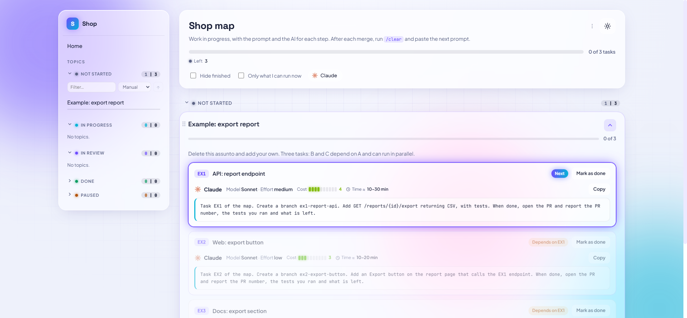

# mapa-skills

[Português](README.md)

Four Claude Code skills that organize a project in small steps (one pull request per task) and let Claude run many tasks on its own.

| Skill | What for |
|---|---|
| `/mapa` | Creates and keeps the project **map**: one HTML file with each plan (topic) split into tasks, each with a ready-to-copy prompt, the AI, the model, the effort, the estimated cost and its dependencies. |
| `/fila` | You paste a task prompt and the session **waits** until its dependencies are done in the map before starting. |
| `/planejamento` | You send many screenshots and change requests; Claude **only takes notes** until you say you are done, then plans, asking about anything unclear. |
| `/orquestrador` | The session becomes the **orchestrator**: it runs a whole topic or a range of tasks (`A10..A20`) with subagents (Opus, Sonnet, Haiku), following the dependencies, in parallel when possible, consulting Fable when unsure and asking before each merge. |



## Install

Requirements: [Claude Code](https://claude.com/claude-code), Node.js 18+, git. `/orquestrador` also uses the [GitHub CLI](https://cli.github.com/) (`gh`).

**As a plugin** (commands become `/mapa:mapa`, `/mapa:fila`...):

```
/plugin marketplace add thales8461/mapa-skills
/plugin install mapa@mapa-skills
```

**As loose skills** (commands stay `/mapa`, `/fila`...): copy the four folders under `skills/` to `~/.claude/skills/`. Keep the four together: `fila` and `orquestrador` use the script in the `mapa` folder.

The skill instructions are in English; Claude replies in your language. Field names inside the map data are in Portuguese (glossary in [`schema.md`](skills/mapa/references/schema.md)).

## Getting started

1. In your project, send `/mapa` and ask for a new map. Claude asks for the name, the language (pt or en) and where to save it, and creates the file with an example topic.
2. Create `.claude/mapa.json` in the project (`/mapa` offers to). Minimum: `{"map": "docs/mapa.html"}`. All options: [`skills/mapa/references/config.md`](skills/mapa/references/config.md) and [`examples/mapa.json`](examples/mapa.json).
3. Open the map in the browser. It refreshes itself while the agents work.
4. Plan (`/planejamento` or your own way). Approved plan → ask Claude to add it to the map.
5. Run the tasks:
   - one per session: **Copy** button in the map, then paste the prompt (with `/fila` first if it depends on another task);
   - many at once: `/orquestrador <topic>` or `/orquestrador from A10 to A20`, or `/orquestrador ... priority on A12`.

## How the orchestrator works

- Each task gets a worktree and a subagent on the model named in the map. Worktrees are created one at a time.
- Tasks with no dependency between them run in parallel (limits in `parallel.max` and `parallel.maxHeavy`).
- A task starts when its dependency is merged **or** has its PR ready and reviewed (that branch is merged into the new worktree).
- Questions: the orchestrator tries to answer; when unsure, it consults Fable; when neither is sure, the task stops and it asks you. The other tasks go on.
- Task ready: it asks whether it can merge. No answer in 2 minutes (`mergeWaitSeconds`): the merge waits for the end, together with the others.
- To follow from your phone, type `/rc` (Remote Control) in the session. The model cannot turn it on; to have it always on, set `"remoteControlAtStartup": true` in `~/.claude/settings.json`.

## The map

One HTML file, no server. The data lives in the `DADOS` block (between `// <mapa-dados>` and `// </mapa-dados>`); agents edit only that block. Format: [`skills/mapa/references/schema.md`](skills/mapa/references/schema.md).

- Groups: Not started, In progress, In review, Done, Paused.
- Task badges: Next, Can run in parallel, Depends on..., Working, Queued, PR open, Done.
- Filter by AI, "Only what I can run now", light and dark theme, drag to reorder.
- The **Copy** button prepends the instruction for the agent to mark `trabalhando` and later `feita`.

Helper script (read-only, never changes an existing map):

```
node skills/mapa/scripts/mapa.mjs init docs/mapa.html --name "My project" --lang en
node skills/mapa/scripts/mapa.mjs summary
node skills/mapa/scripts/mapa.mjs validate
node skills/mapa/scripts/mapa.mjs tasks <dir> "My topic"
node skills/mapa/scripts/mapa.mjs check EX1 EX2
```

## License

[MIT](LICENSE)
