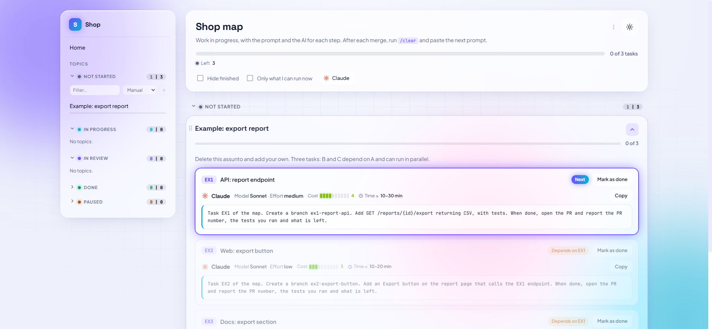

# mapa-skills

[Português](README.md)

Nine Claude Code skills that organize a project in small steps (one pull request per task) and let Claude run many tasks on its own.

| Skill | What for |
|---|---|
| `/mapa` | Creates and keeps the project **map**: one HTML file with each plan (topic) split into tasks, each with a ready-to-copy prompt, the AI, the model, the effort, the estimated cost and its dependencies. |
| `sino` | Runs **on its own** when something waits for your approval or answer (report, mockup, plan, PR to merge): adds an item to the **bell** at the top of the map, with a counter, and removes it when you answer. When the wait blocks a task, the task gets the "Depends on artifact" badge with the page link. Questions go as a subject on one of the fixed **question pages**. |
| `/ler-artifact` | Reads the **question pages**, saves each answered subject to the project memory, frees the tasks that waited for it, swaps its bell item for an "answered" notice, asks what to do with the "I don't know, forward to" answers, deletes the answered subjects from the pages (with your approval) and lists the tasks that can start now. |
| `/fila` | You paste a task prompt and the session **waits** until its dependencies are done in the map before starting. |
| `/pos` | `/pos A1` + the A2 prompt: A2 starts only after A1 is **merged**, even without depending on it (to run in sequence tasks that could run in parallel). |
| `/planejamento` | You send many screenshots and change requests; Claude **only takes notes** until you say you are done, then plans, asking about anything unclear. |
| `/orquestrador` | The session becomes the **orchestrator**: it runs a whole topic or a range of tasks (`A10..A20`) with subagents (Opus, Sonnet, Haiku), following the dependencies, in parallel when possible, consulting Fable when unsure and asking before each merge. |
| `prompt-revisao` | Runs **on its own** when the last task of a topic is merged: writes in the map the final review prompt for another model (Gemini, Codex...), with a separate part for the sensitive area, if any. |
| `/revisao` | Reads the **review reports** not handled yet, confirms each finding on `main`, proposes the fix tasks (they go to the map after your approval) and moves to the done folder every report with nothing to fix. |



## Install

Requirements: [Claude Code](https://claude.com/claude-code), Node.js 18+, git. `/orquestrador` also uses the [GitHub CLI](https://cli.github.com/) (`gh`).

**As a plugin** (commands become `/mapa:mapa`, `/mapa:fila`...):

```
/plugin marketplace add thales8461/mapa-skills
/plugin install mapa@mapa-skills
```

**As loose skills** (commands stay `/mapa`, `/fila`...): copy the nine folders under `skills/` to `~/.claude/skills/`. Keep them together: `fila`, `pos`, `orquestrador`, `prompt-revisao`, `revisao` and `ler-artifact` use the script in the `mapa` folder.

The skill instructions are in English; Claude replies in your language. Field names inside the map data are in Portuguese (glossary in [`schema.md`](skills/mapa/references/schema.md)).

## Getting started

1. In your project, send `/mapa` and ask for a new map. Claude asks for the name, the language (pt or en) and where to save it, and creates the file with an example topic.
2. Create `.claude/mapa.json` in the project (`/mapa` offers to). Minimum: `{"map": "docs/mapa.html"}`. All options: [`skills/mapa/references/config.md`](skills/mapa/references/config.md) and [`examples/mapa.json`](examples/mapa.json).
3. Open the map in the browser. It refreshes itself while the agents work.
4. Plan (`/planejamento` or your own way). Approved plan → ask Claude to add it to the map.
5. Run the tasks:
   - one per session: **Copy** button in the map, then paste the prompt (with `/fila` first if it depends on another task);
   - many at once: `/orquestrador <topic>` or `/orquestrador from A10 to A20`, or `/orquestrador ... priority on A12`.

## How the orchestrator works

- Each task gets a worktree and a subagent on the model named in the map. Worktrees are created one at a time.
- Tasks with no dependency between them run in parallel (limits in `parallel.max` and `parallel.maxHeavy`).
- A task starts when its dependency is merged **or** has its PR ready and reviewed (that branch is merged into the new worktree).
- Questions: the orchestrator tries to answer; when unsure, it consults Fable; when neither is sure, the task stops and it asks you. The other tasks go on.
- Task ready: it asks whether it can merge. No answer in 2 minutes (`mergeWaitSeconds`): the merge waits for the end, together with the others.
- At the top of the map, the **Orchestrators working** panel shows each running orchestrator: the request, since when, the progress and each task with its status (running, PR ready, merge at the end, question, waiting, merged); when only the merge is left, the card gets a green **Only the merge left** badge.
- To follow from your phone, type `/rc` (Remote Control) in the session. The model cannot turn it on; to have it always on, set `"remoteControlAtStartup": true` in `~/.claude/settings.json`.

## The map

One HTML file, no server. The data lives in the `DADOS` block (between `// <mapa-dados>` and `// </mapa-dados>`); agents edit only that block. Format: [`skills/mapa/references/schema.md`](skills/mapa/references/schema.md).

- Groups: Not started, In progress, In review, Done, Paused.
- Task badges: Next, Can run in parallel, Depends on..., Working, Queued, PR open, Done.
- Filter by AI, "Only what I can run now", light and dark theme, drag to reorder.
- The **Copy** button prepends the instruction for the agent to mark `trabalhando` and later `feita`.
- The **Mark pasted** button next to it records (only in your browser, with date and time) that you already pasted that prompt into the AI; click again to unmark. A rewritten prompt comes back unmarked.
- Sidebar shortcuts: **Orchestrators** (red counter with the ones running), **Question pages** (counter with the "answered" bell notices not dismissed yet) and **Skills**; the last two open the collapsed section and scroll to it.
- In the bell, the notice of an answered subject has an ✕ that dismisses it only in your browser.

Helper script (read-only, never changes an existing map):

```
node skills/mapa/scripts/mapa.mjs init docs/mapa.html --name "My project" --lang en
node skills/mapa/scripts/mapa.mjs summary
node skills/mapa/scripts/mapa.mjs validate
node skills/mapa/scripts/mapa.mjs tasks <dir> "My topic"
node skills/mapa/scripts/mapa.mjs check EX1 EX2
node skills/mapa/scripts/mapa.mjs ready
```

`ready` lists the tasks that can start now (dependencies done, nobody working, no PR, queue or `aguarda`, topic not paused) and, apart, the ones waiting only for an answer on a page.

## Question pages

Instead of a new artifact for every round of questions, the project keeps a few **fixed pages**, one per person or team (for example Finance, Product, Me), made from [`skills/mapa/assets/perguntas-template.html`](skills/mapa/assets/perguntas-template.html) and listed in `paginas` in the map. The questions live in the artifact database, so asking something new does not require republishing the page.

- One collapsible menu per subject, closed when the page opens, sorted by priority; inside, the questions with options, the recommended one marked, "I don't know, forward to: [another page]" and "Other" (free text), a note field and a "See the context" button.
- Subject priority:
  - **baixa** (low): a new module with only a study done, or not even that;
  - **media** (medium): can wait without getting in the way now, or belongs to a phase 2;
  - **alta** (high): needed to run the next task, but other work can still go first;
  - **urgente** (urgent): shown as "Urgent: development blocked by these pending items".
- How to create a page, the database permissions and the format: [`skills/mapa/references/perguntas.md`](skills/mapa/references/perguntas.md).
- The `sino` skill puts the questions on the page; `/ler-artifact` brings the answers back.

## License

[MIT](LICENSE)
