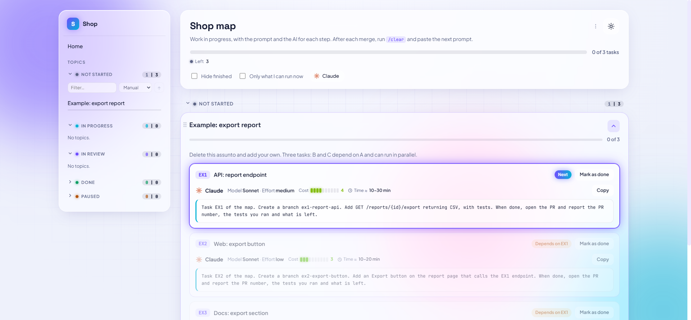

# mapa-skills

[English](README.en.md)

Sete skills para o Claude Code que organizam projetos em etapas pequenas (uma PR por tarefa) e deixam o Claude rodar várias tarefas sozinho.

| Skill | Para quê |
|---|---|
| `/mapa` | Cria e mantém o **mapa** do projeto: um HTML com cada plano (assunto) dividido em tarefas, com o prompt pronto para copiar, a IA, o modelo, o esforço, o gasto estimado e as dependências. |
| `/fila` | Você cola o prompt de uma tarefa e a sessão **espera** as dependências ficarem feitas no mapa antes de começar. |
| `/pos` | `/pos A1` + o prompt da A2: a A2 só começa depois que a A1 for **mesclada**, mesmo sem depender dela (para rodar em sequência tarefas que poderiam ir em paralelo). |
| `/planejamento` | Você manda vários prints e pedidos; o Claude **só anota** até você dizer que terminou, e aí planeja, perguntando o que não estiver claro. |
| `/orquestrador` | A sessão vira **orquestradora**: roda um assunto inteiro ou um intervalo de tarefas (`A10..A20`) com subagentes (Opus, Sonnet, Haiku), respeitando as dependências, em paralelo quando dá, consultando o Fable nas dúvidas e perguntando antes de mesclar. |
| `prompt-revisao` | Chamada **sozinha** quando a última tarefa de um assunto é mesclada: grava no mapa o prompt da revisão final para outro modelo (Gemini, Codex...), com uma parte separada para a área sensível, se houver. |
| `/revisao` | Lê os **relatórios de revisão** ainda não tratados, confere cada achado na `main`, propõe as tarefas de correção (com a sua aprovação vão para o mapa) e manda para a pasta de concluídos o que não tem nada a corrigir. |



## Instalar

Requisitos: [Claude Code](https://claude.com/claude-code), Node.js 18+, git. O `/orquestrador` usa também o [GitHub CLI](https://cli.github.com/) (`gh`).

**Como plugin** (os comandos ficam `/mapa:mapa`, `/mapa:fila`...):

```
/plugin marketplace add thales8461/mapa-skills
/plugin install mapa@mapa-skills
```

**Como skills soltas** (os comandos ficam `/mapa`, `/fila`...): copie as sete pastas de `skills/` para `~/.claude/skills/`. Mantenha todas juntas: `fila`, `pos`, `orquestrador`, `prompt-revisao` e `revisao` usam o script da pasta `mapa`.

## Começar

1. No projeto, mande `/mapa` e peça um mapa novo. O Claude pergunta o nome, o idioma (pt ou en) e onde salvar, e cria o arquivo com um assunto de exemplo.
2. Crie `.claude/mapa.json` no projeto (o `/mapa` oferece). Mínimo: `{"map": "docs/mapa.html"}`. Todas as opções: [`skills/mapa/references/config.md`](skills/mapa/references/config.md) e [`examples/mapa.json`](examples/mapa.json).
3. Abra o mapa no navegador. Ele se atualiza sozinho enquanto os agentes trabalham.
4. Planeje (`/planejamento` ou do seu jeito). Plano aprovado → peça ao Claude para colocar no mapa.
5. Rode as tarefas:
   - uma por sessão: botão **Copiar** no mapa e cole o prompt (com `/fila` antes, se ela depende de outra);
   - várias de uma vez: `/orquestrador <assunto>` ou `/orquestrador da A10 até a A20`, ou `/orquestrador ... prioridade na A12`.

## Como o orquestrador trabalha

- Cada tarefa ganha uma worktree e um subagente no modelo indicado no mapa. As worktrees são criadas uma por vez.
- Tarefas sem dependência entre si rodam em paralelo (limites em `parallel.max` e `parallel.maxHeavy`).
- Uma tarefa começa quando a dependência está mesclada **ou** com a PR pronta e revisada (a branch dela entra na worktree nova).
- Dúvida: o orquestrador tenta resolver; se não tiver certeza, consulta o Fable; se nenhum dos dois tiver certeza, a tarefa para e ele pergunta a você. As outras continuam.
- Tarefa pronta: ele pergunta se pode mesclar. Sem resposta em 2 minutos (`mergeWaitSeconds`), deixa para mesclar com as outras no fim.
- Para acompanhar pelo celular, digite `/rc` (Remote Control) na sessão. O modelo não consegue ligar sozinho; para ligar sempre, use `"remoteControlAtStartup": true` no `~/.claude/settings.json`.

## O mapa

Um arquivo HTML só, sem servidor. Os dados ficam no bloco `DADOS` (entre `// <mapa-dados>` e `// </mapa-dados>`); os agentes mexem só nele. Formato: [`skills/mapa/references/schema.md`](skills/mapa/references/schema.md).

- Grupos: Não iniciados, Em desenvolvimento, Em revisão, Concluídos, Em pausa.
- Selos por tarefa: Próxima, Pode rodar em paralelo, Depende de..., Trabalhando, Na fila, PR aberta, Feita.
- Filtros por IA, "Só as que posso rodar agora", tema claro e escuro, ordem por arrastar.
- O botão **Copiar** põe no começo do prompt a instrução para o agente marcar `trabalhando` e depois `feita`.

Script de apoio (só lê, nunca altera um mapa existente):

```
node skills/mapa/scripts/mapa.mjs init docs/mapa.html --name "Meu projeto" --lang pt
node skills/mapa/scripts/mapa.mjs summary
node skills/mapa/scripts/mapa.mjs validate
node skills/mapa/scripts/mapa.mjs tasks <pasta> "Meu assunto"
node skills/mapa/scripts/mapa.mjs check EX1 EX2
```

## Licença

[MIT](LICENSE)
